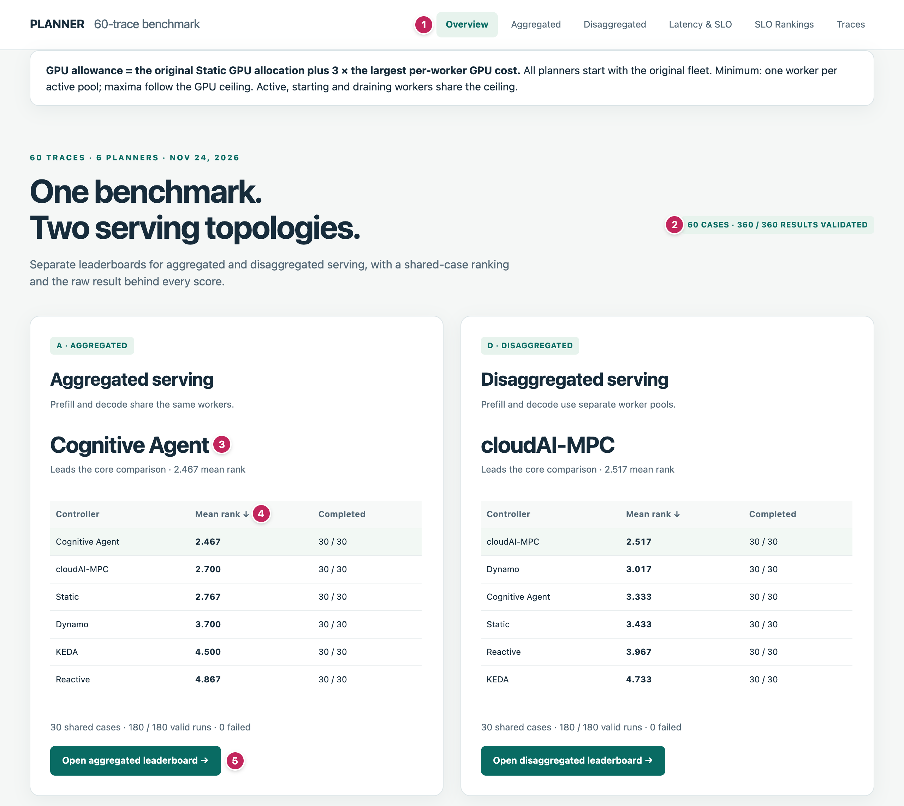
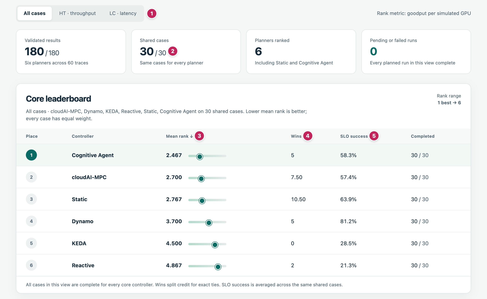
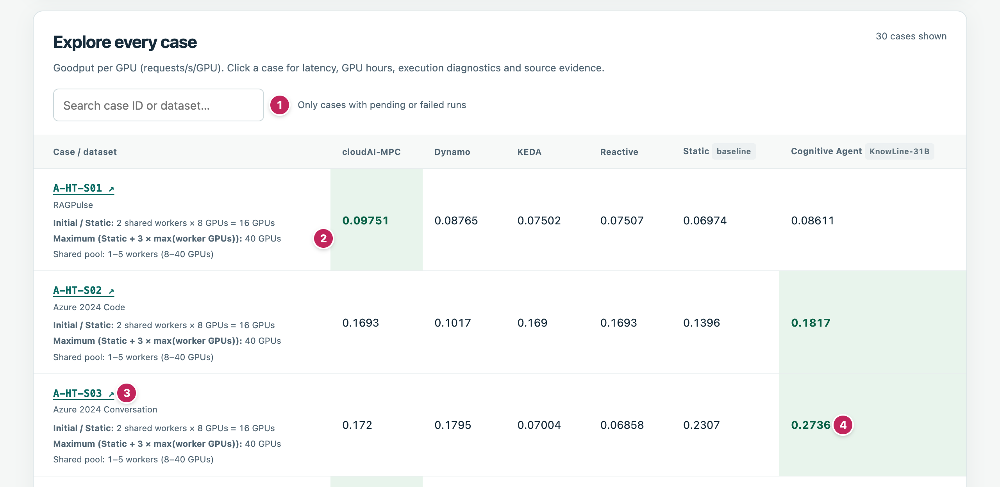
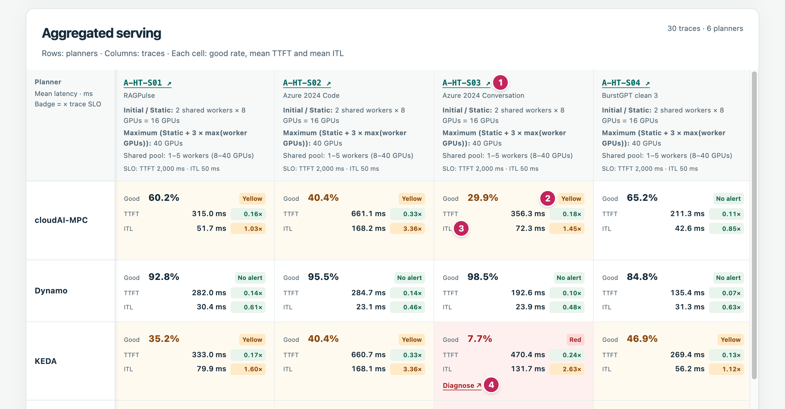
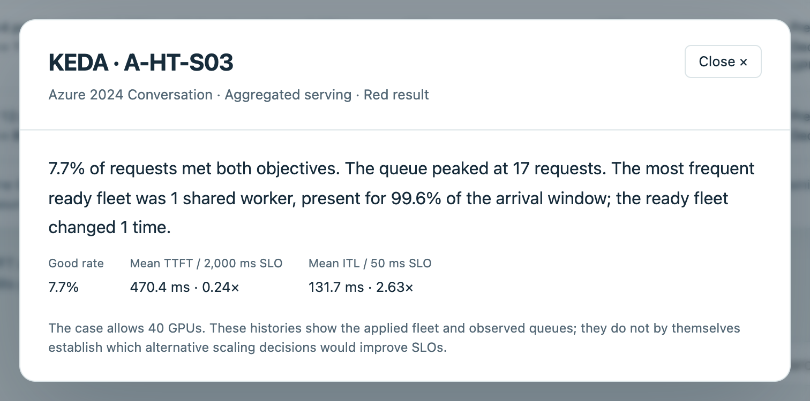
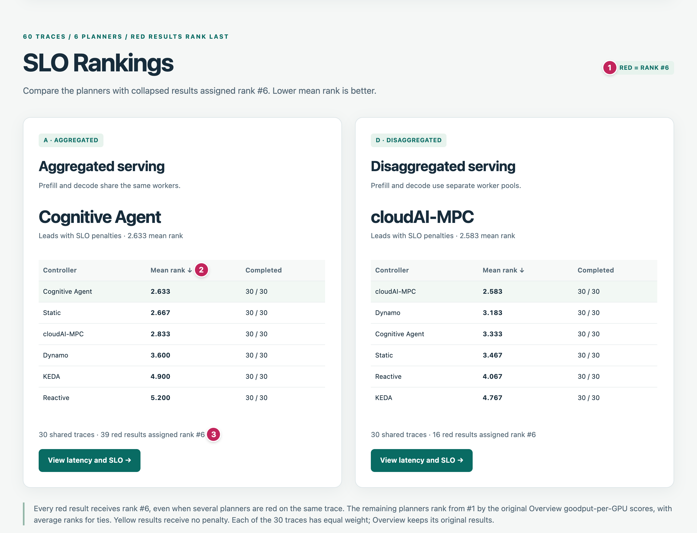
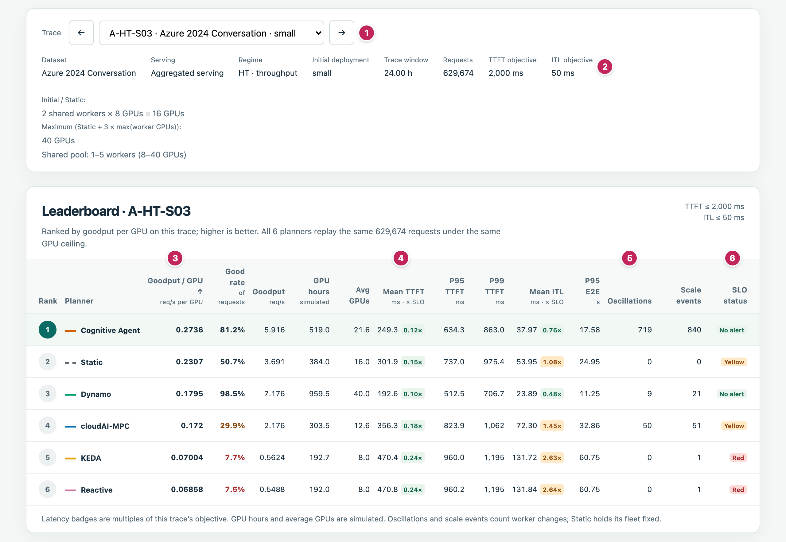
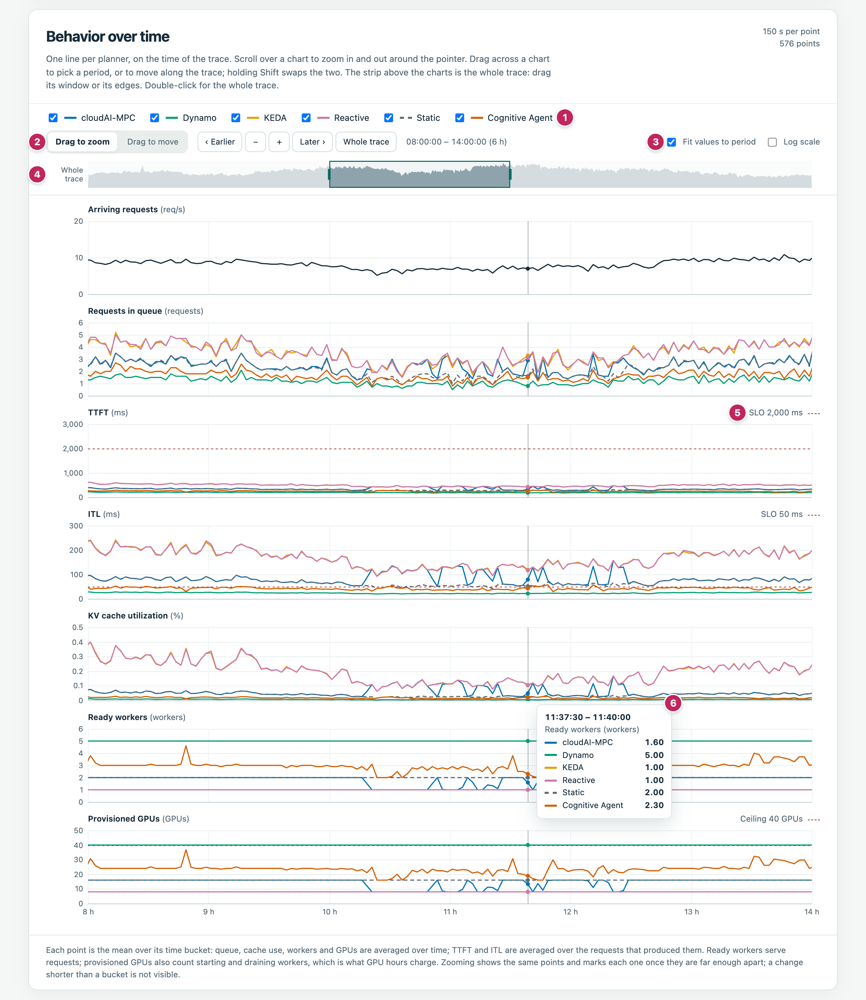

<!--
SPDX-FileCopyrightText: Copyright (c) 2026 NVIDIA CORPORATION & AFFILIATES. All rights reserved.
SPDX-License-Identifier: Apache-2.0
-->

# Planner Gym: 60-trace planner leaderboard

Planner Gym compares autoscaling planners for LLM serving. Six planners replay
the same 60 traces in simulation, 30 on aggregated and 30 on disaggregated
serving, under the same GPU ceiling. The result is an interactive leaderboard of
all 360 runs, ranked by **goodput per GPU**: one self-contained HTML report that
works offline.

**Open it:** [`leaderboards/60traces/index.html`](leaderboards/60traces/index.html)
from a local checkout, in any browser. [More ways to open it](#open-the-leaderboard).



The Overview tab:

1. **Six tabs.** Each is a standalone page of the same report.
2. **Validated results.** Only results that pass validation are scored: 360 of 360.
3. **Leader** of each serving topology.
4. **Mean rank** of every planner; lower is better.
5. **Opens the full leaderboard** of that topology.

| Planner | What it is |
| --- | --- |
| cloudAI-MPC | The Gym's model predictive controller ([details](docs/mpc.md)) |
| Dynamo | The Dynamo planner |
| KEDA | Port of the KEDA/HPA scaling policy |
| Reactive | Reactive scaling policy |
| Static | Keeps the original fleet for the whole trace; the baseline |
| Cognitive Agent | Scaling agent built around the open KnowLine-31B decision model ([details](docs/knowline.md)) |

This directory holds the leaderboard and everything that produces it: the replay
runners, the planners, the Cognitive Agent's serving and GPU campaign tools,
result import, analysis and the page builder.

## What each tab answers

| Tab | Question it answers | What you can do there |
| --- | --- | --- |
| Overview (above) | Who leads each serving topology? | Compare mean ranks; read the GPU policy and the scoring rules |
| [Aggregated, Disaggregated](#aggregated-and-disaggregated) | How do the planners rank on one topology, and on each trace? | Switch between all, throughput and latency traces; search traces; open any trace's details |
| [Latency & SLO](#latency--slo) | Did a planner serve within the latency objectives? | Scan 360 color-flagged cells; open the diagnosis of a failed result |
| [SLO Rankings](#slo-rankings) | Does the ranking hold if failed results are penalised? | Compare with the Overview ranking |
| [Traces](#traces) | What happened on one trace, and when? | Read every metric of the six planners; zoom into their queue, latency, workers and GPUs over time |

## The ranking rules

- **Goodput per GPU** is the score of one planner on one trace: requests per
  second that met both latency objectives, divided by the average number of
  simulated GPUs over the trace. Higher is better.
- **Rank per trace.** The six planners are ranked 1 to 6 by that score. Exact
  ties share the average rank and split the win.
- **Mean rank** over the traces of a topology orders the leaderboard. Lower is
  better and every trace has equal weight. Only traces that all six planners
  completed count; today that is all 30 per topology.
- **Good rate**, shown as **SLO success**, is the share of attempted requests
  that met both objectives. It is reported next to the rank and is not part of
  it.
- **Same GPU ceiling for everyone.** Each trace allows the original Static GPU
  allocation plus 3 × the largest per-worker GPU cost. Every planner starts
  with the original fleet and Static keeps it. Active, starting and draining
  workers all count against the ceiling. GPU hours are simulated serving GPUs;
  the physical GPUs that run the Cognitive Agent's model are not included.

A trace ID such as `A-HT-S03` reads: serving topology (`A` aggregated, `D`
disaggregated), regime (`HT` throughput-focused, `LC` latency-focused), then the
initial deployment (`S01`–`S10` start with 2 workers, `L01`–`L05` with 16). The
regime sets the latency objectives:

| Regime | Traces | TTFT objective | ITL objective |
| --- | --- | ---: | ---: |
| HT · throughput | S01–S07, L01–L03 | 2,000 ms | 50 ms |
| HT · throughput | S08–S10, L04–L05 | 5,000 ms | 50 ms |
| LC · latency | S01–S07, L01–L03 | 500 ms | 15 ms |
| LC · latency | S08–S10, L04–L05 | 1,500 ms | 15 ms |

TTFT is time to first token and ITL is the request-mean inter-token latency.
The [trace inventory](docs/traces-60.md) lists the dataset behind each trace.

## Reading each tab

The figures below follow one trace, `A-HT-S03`, through the tabs.

### Aggregated and Disaggregated

One tab per serving topology, with the same layout. Aggregated workers do both
prefill and decode; disaggregated serving has a prefill pool and a decode pool.



1. **Regime switch.** All 30 traces, the 15 throughput-focused ones or the 15
   latency-focused ones. Everything below follows it.
2. **Shared cases.** The traces every planner completed. Only these are ranked.
3. **Mean rank** orders the table. The marker shows it between 1 (best) and 6.
4. **Wins.** Traces on which the planner had the best score; a tie splits the win.
5. **SLO success.** Mean good rate on the same traces. Read it with the rank:
   here Dynamo meets the objectives most often and is fourth, as it also uses
   the most GPU hours.



1. **Search** by trace ID or dataset, or show only traces with pending or failed runs.
2. **Fleet of the trace.** The starting fleet, the GPU ceiling and the worker bounds.
3. **Trace ID.** Opens the trace's details: objectives, each planner's score,
   goodput, SLO success, GPU hours and P99 TTFT, the Cognitive Agent's model
   decisions and decision latency, the simulation's wall time and memory, the
   fingerprints of the source results, and a link to the trace in the Traces tab.
4. **Score.** Goodput per GPU; the best of the row is highlighted. Hover a cell
   for that run's SLO success.

### Latency & SLO

A planner can score well and still miss its objectives. This tab shows, for all
360 results, how many requests met the objectives and how far the mean latency
is from them. It opens with the counts per color, the objectives and the color
rules, followed by one matrix per topology.



1. **Column: one trace**, with its fleet, ceiling and objectives. The trace ID
   opens the trace's details.
2. **Flag.** The worst of the three checks in the cell, by the rules below.
3. **Cell.** Good rate, mean TTFT and mean ITL. The badge is the mean divided by
   the objective: `1.45×` is 45% over.
4. **Diagnose.** Every red cell explains itself from the saved queue and fleet
   history of that run.

| Flag | Rule |
| --- | --- |
| Red | Good rate below 20%, or mean TTFT or mean ITL at least 5 × its objective |
| Yellow | Not red, and good rate at most 50% or a mean above its objective |
| No alert | Good rate above 50% and both means within their objectives |

"No alert" does not mean that every request met its objectives.



### SLO Rankings

The main ranking rewards efficiency. This tab repeats it with a penalty for
results that failed their objectives, to show whether a planner's place depends
on them.



1. **The rule.** Every red result gets rank 6 on its trace, even when several
   planners are red on it.
2. **Mean rank** with that penalty. The other planners rank from 1 by goodput
   per GPU as before; yellow results are not penalised.
3. **Red results** that received rank 6 in this topology.

Compared with the Overview, Static and cloudAI-MPC swap second and third place
on aggregated serving, and the leaders stay.

### Traces

One trace at a time: every metric of the six planners, then their behavior
while the trace replayed. A trace's details in the other tabs link here, and the
address names the trace (`traces.html#A-HT-S03`), so a view can be shared.



1. **Trace picker.** The 60 traces by topology and regime; the arrows step through them.
2. **Trace facts.** Dataset, regime, length, requests, objectives, fleet and ceiling.
3. **Goodput per GPU** ranks the planners on this trace.
4. **Latency.** Mean, P95 and P99 TTFT, mean ITL and P95 end-to-end latency. The
   badges are multiples of the objective.
5. **Scaling activity.** Scale events are changes of a pool's worker count;
   oscillations are reversals, a pool scaled one way and then back.
6. **SLO status.** The flag of the Latency & SLO tab.

On this trace Dynamo serves 98.5% of the requests within the objectives but holds
40 GPUs, so it is third. The Cognitive Agent serves 81.2% with 21.6 GPUs on
average and is first. KEDA and Reactive stay at 8 GPUs and are red.



1. **One line per planner.** The checkboxes hide and show planners.
2. **Zoom and move.** Scroll over a chart to zoom around the pointer. Drag to
   pick a period, or choose "Drag to move" to slide along the trace; Shift swaps
   the two. The buttons and the arrow, `+`, `-` and `0` keys do the same, and a
   double-click returns to the whole trace.
3. **Value axes** fit the period shown, or the whole trace when the box is
   cleared. A log scale is available for queue and latency.
4. **The whole trace**, with the period shown as a window to drag or resize.
5. **Objectives.** Dashed red lines mark the TTFT and ITL objectives, and the
   GPU ceiling on the last chart.
6. **Hover** for every planner's value in that time bucket.

The charts share one time axis: arriving requests, requests in queue, TTFT, ITL,
KV cache utilization, prefix cache reuse, ready workers (prefill and decode
separately on disaggregated serving) and provisioned GPUs. Each point is a mean
over a time bucket, and a trace has at most 600 points: 5 seconds to 20 minutes
each, by trace length. The six hours shown explain the table above: Dynamo holds
5 workers, the Cognitive Agent moves between about 2 and 4, and KEDA and
Reactive stay at 1 while their ITL runs far above the 50 ms objective.

## Current standings

All 360 runs were replayed on 2026-11-23 and 2026-11-24 on the plan of the
`efficiency-plus3-20261106` campaign ([how they reproduce](docs/reproducibility.md)).
These tables are the `all` rows of
[leaderboard-summary.csv](leaderboards/60traces/leaderboard-summary.csv).
Every planner completed all 30 traces of each topology.

### Aggregated serving, 30 traces

| Position | Planner | Mean rank ↓ | Wins ↑ | Mean good rate ↑ | Simulated GPU-hours |
| ---: | --- | ---: | ---: | ---: | ---: |
| 1 | Cognitive Agent | 2.467 | 5.00 | 58.26% | 20,011.3 |
| 2 | cloudAI-MPC | 2.700 | 7.50 | 57.43% | 18,821.9 |
| 3 | Static | 2.767 | 10.50 | 63.93% | 27,718.9 |
| 4 | Dynamo | 3.700 | 5.00 | 81.23% | 30,301.1 |
| 5 | KEDA | 4.500 | 0.00 | 28.46% | 13,084.4 |
| 6 | Reactive | 4.867 | 2.00 | 21.26% | 10,952.0 |

### Disaggregated serving, 30 traces

| Position | Planner | Mean rank ↓ | Wins ↑ | Mean good rate ↑ | Simulated GPU-hours |
| ---: | --- | ---: | ---: | ---: | ---: |
| 1 | cloudAI-MPC | 2.517 | 12.00 | 76.93% | 18,787.5 |
| 2 | Dynamo | 3.017 | 6.50 | 62.33% | 15,501.6 |
| 3 | Cognitive Agent | 3.333 | 2.00 | 79.78% | 23,525.8 |
| 4 | Static | 3.433 | 5.83 | 65.53% | 23,897.4 |
| 5 | Reactive | 3.967 | 2.33 | 61.60% | 19,162.5 |
| 6 | KEDA | 4.733 | 1.33 | 64.09% | 21,337.6 |

The same data without a browser:

| File | Contents |
| --- | --- |
| [leaderboard-summary.csv](leaderboards/60traces/leaderboard-summary.csv) | Rankings per topology, for all traces and for HT and LC separately |
| [aggregated-runs.csv](leaderboards/60traces/aggregated-runs.csv), [disaggregated-runs.csv](leaderboards/60traces/disaggregated-runs.csv) | Every run of a topology |
| [static-latency-runs.csv](leaderboards/60traces/static-latency-runs.csv) | Static's latency measurements |
| [leaderboards.json](leaderboards/60traces/leaderboards.json) | The scoring evidence behind every table |
| [validation.json](leaderboards/60traces/validation.json) | The validation record of the saved results |

## Open the leaderboard

Open `leaderboards/60traces/index.html` from a local checkout in a browser. The
six pages need no server, no network and no benchmark run.

GitHub's file viewer shows HTML as source and does not run it. Without a
checkout, open a page on GitHub, select **Download raw file** and open the
downloaded file. Each page is complete by itself; the tab links work when the
six pages are in one folder.

## Rebuild and verify the leaderboard

Python 3.11 or 3.12 is sufficient; replay and GPU inference are unnecessary.
The versioned `leaderboards/60traces/inputs/` contains the complete current
scores, GPU audits, configurations, reduced diagnostic evidence and time series.

```bash
python leaderboards/60traces/build_leaderboards.py
```

To verify the saved HTML, CSV and JSON byte for byte without modifying them:

```bash
python leaderboards/60traces/build_leaderboards.py --check
```

See [reproducibility](docs/reproducibility.md) for the input and runtime pins,
and for how closely a replay reproduces the saved results.
[Report details](leaderboards/60traces/README.md) describe the scoring, the
inputs and their validation.

After publishing new results, refresh the tables under
[Current standings](#current-standings) from the `all` rows of
`leaderboard-summary.csv`, and capture the figures of this page again:

```bash
CHROME_ENDPOINT=http://127.0.0.1:9222 node leaderboards/60traces/capture_figures.mjs
```

## Resources

| Work | CPU and RAM | Physical GPUs |
| --- | --- | --- |
| Rebuild saved HTML and analysis | 1 CPU, 1 GiB RAM | 0 |
| Full CPU replay campaign | Example policy: 8 CPU cores, 512 GiB RAM; up to 8 runs on distinct single-core slots, reserving 64 GiB | 0 |
| One KnowLine decision server | Budget 16 CPU cores; replay RAM remains subject to each trace's reservation | 2 × 80 GiB GPUs for bf16 weights |
| Parallel GPU campaign | Per node: 64 CPU cores, about 2 TiB RAM; 4 replay/server lanes with 384 GiB replay RSS guards | 8 × 80 GiB GPUs per node |

CPU and memory settings are configurable. The planner checks reservations and
available capacity before starting work; large jobs run alone when required.
These are execution profiles, not measured minimum requirements. The GPU
campaign defaults to two node queues with four concurrent traces per node.
The longest cases start on separate nodes; smaller cases fill each free lane,
reusing its loaded model. `--nodes` sets the node count when preparing a campaign.
Serving GPUs shown in the result tables are simulated allocations. Only the
KnowLine decision model needs physical GPUs.

## Run the benchmark

On Linux, install the native replay runtime and this package:

```bash
bash scripts/setup_simulation_env.sh
source .venv/bin/activate
python -m pip install -e '.[sim,jev,analysis,test]' numpy
```

Both Cargo workspaces use the optimized scheduler in `../../vendor/aisimulate-core`.
The runner requires `incremental-queue-stats-v1`. Replay streams request results
to JSONL, skips detailed per-tick planner charts, and retains lifecycle events
for exact GPU-hour scoring plus sampled telemetry for diagnosis. Full trace
windows, seeds, request counts, SLOs, and worker limits remain intact.

Prepare the inputs using [data/README.md](data/README.md), then:

```bash
python scripts/run_campaign.py cpu --workspace runs/benchmark
```

The CPU command prepares and executes all 300 CPU jobs on up to eight cores.
The same entry point starts all 60 KnowLine cases on two GPU nodes after model
setup, as described in [docs/comparison-60.md](docs/comparison-60.md). It checks
native source and binary identity before reusing a runtime. Server replacement,
memory isolation and allocation continuation are part of the maintained
scheduler. Completed cases are preserved; no separate recovery script is needed.

The decision contract is documented in [docs/knowline.md](docs/knowline.md).

## Collect and publish a new campaign

```bash
python scripts/run_campaign.py collect --kind cpu --workspace runs/benchmark
python scripts/run_campaign.py collect --kind knowline --workspace runs/benchmark
python scripts/run_campaign.py publish --collection runs/benchmark/exports
```

Collect on the machine holding each campaign, then place both export directories
under one local `exports/` directory before publication. Collection requires
resident-GPU audits and complete trace measurements. The publisher accepts all
300 CPU and 60 KnowLine exports and refreshes analysis for their exact hashes.
Detailed timeline extraction remains available through `extract_diagnostics.py`.
The curves of the Traces tab come from each run's telemetry; see
[report details](leaderboards/60traces/README.md#traces-tab).

The local `runs/efficiency-plus3-20261106/` retains the first campaign's 360
compact exports, transfer manifests and source/runtime identity receipts. It is
the default `--collection`, so `publish` without one puts that campaign's
results back in place of the saved replays. Large input traces and these local
bundles are ignored by Git.

The versioned compact `inputs/` remain sufficient to rebuild HTML after a fresh
checkout. The expanded traces can be regenerated from `reproduction/` when a new
replay is required.

## Validate

```bash
python -m pytest -q tests leaderboards/60traces
```

Browser checks use `leaderboards/60traces/check_browser.mjs` with a local
Chrome DevTools endpoint supplied through `CHROME_ENDPOINT`.
